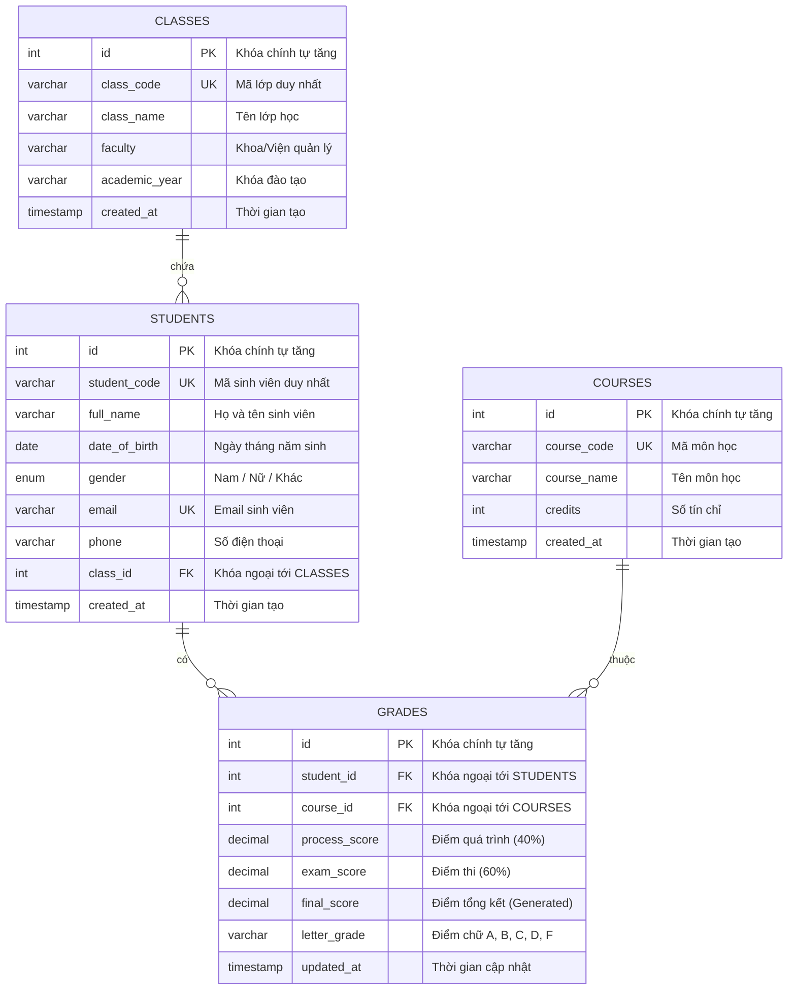

# BỘ GIÁO DỤC VÀ ĐÀO TẠO
## TRƯỜNG ĐẠI HỌC CÔNG NGHỆ THÔNG TIN VÀ TRUYỀN THÔNG
### KHOA CÔNG NGHỆ THÔNG TIN

---
<br><br><br>

# BÁO CÁO THỰC HÀNH MÔN HỌC
## TRIỂN KHAI VÀ QUẢN TRỊ HỆ THỐNG PHẦN MỀM

<br>

### **ĐỀ TÀI SỐ 02:**
# TRIỂN KHAI VÀ QUẢN TRỊ HỆ THỐNG QUẢN LÝ SINH VIÊN TRÊN NỀN TẢNG CONTAINER VỚI NGINX REVERSE PROXY, PROMETHEUS, GRAFANA, LOKI VÀ HARDENING BẢO MẬT

<br><br><br>

**Sinh viên thực hiện:** NGUYỄN ĐĂNG KHOA  
**Mã số sinh viên:** DTC245200257  
**Lớp chuyên ngành:** Công nghệ Thông tin K18  
**Giảng viên hướng dẫn:** Bộ môn Quản trị Hệ thống & Mạng  
**Link GitHub Repository:** [https://github.com/dtc245200257-cell/de02_quanlysinhvien](https://github.com/dtc245200257-cell/de02_quanlysinhvien)  

<br><br>

---
**HÀ NỘI – NĂM 2026**

<div style="page-break-after: always;"></div>

# LỜI MỞ ĐẦU

Trong kỷ nguyên chuyển đổi số và phát triển phần mềm hiện đại, việc đóng gói, triển khai và duy trì các hệ thống ứng dụng đóng vai trò quan trọng không kém gì công đoạn viết mã nguồn. Các phương pháp quản trị truyền thống (triển khai trực tiếp lên máy vật lý, cấu hình thủ công) bộc lộ nhiều điểm nghẽn nghiêm trọng về tính bất đồng nhất của môi trường, khả năng mở rộng kém và khó khăn trong việc giám sát, khắc phục sự cố.

Sự ra đời của công nghệ Container hóa (Containerization) với hạt nhân là Docker và công cụ điều phối Docker Compose đã tạo ra cuộc cách mạng trong quy trình DevOps. Container cho phép đóng gói ứng dụng cùng toàn bộ thư viện phụ thuộc thành một khối độc lập, đảm bảo phần mềm hoạt động nhất quán trên mọi môi trường từ máy phát triển nội bộ đến các máy chủ đám mây.

Báo cáo này trình bày toàn diện quá trình nghiên cứu, thiết kế, triển khai và gia cố an toàn cho **Đề tài số 02: Hệ thống Quản lý Sinh viên** thuộc học phần *Triển khai và Quản trị Hệ thống Phần mềm*. Báo cáo mô tả chi tiết 6 tiêu chuẩn kỹ thuật cốt lõi:
1. Quản lý mã nguồn theo phiên bản trên GitHub với 03 mốc commit có cấu trúc rõ ràng.
2. Triển khai ứng dụng Web tương tác kết nối Cơ sở dữ liệu quan hệ MySQL và công cụ quản trị trực quan phpMyAdmin.
3. Thiết lập Nginx làm Reverse Proxy bảo mật, tích hợp chứng chỉ mã hóa SSL/TLS tự ký, chuyển hướng HTTP sang HTTPS và hệ thống Security Headers.
4. Xây dựng hệ thống giám sát toàn diện thời gian thực bằng Prometheus kết hợp Grafana Dashboard và các Exporter chuyên dụng (MySQL Exporter, Node Exporter, cAdvisor).
5. Xây dựng hệ thống thu thập và phân tích log tập trung sử dụng Grafana Loki và Promtail, khai thác cú pháp truy vấn LogQL.
6. Áp dụng các giải pháp gia cố bảo mật chuyên sâu (Hardening): Chạy container với tài khoản non-root, cô lập mạng theo phân vùng (Network Isolation), nguyên tắc đặc quyền tối thiểu (Least Privilege), và kiểm soát tài nguyên phần cứng.

Toàn bộ hệ thống được kiểm thử thực tế và vận hành ổn định trên môi trường máy chủ Linux Ubuntu Server 24.04 LTS (Địa chỉ IP: `192.168.253.129`).

<div style="page-break-after: always;"></div>

# MỤC LỤC BÁO CÁO

- **LỜI MỞ ĐẦU**
- **CHƯƠNG 1: TỔNG QUAN ĐỀ TÀI VÀ PHÂN TÍCH YÊU CẦU**
  - 1.1. Mục tiêu và phạm vi đề tài
  - 1.2. Phân tích yêu cầu chức năng nghiệp vụ
  - 1.3. Phân tích yêu cầu kỹ thuật và tiêu chí đánh giá
  - 1.4. Lựa chọn ngăn xếp công nghệ (Technology Stack)
- **CHƯƠNG 2: THIẾT KẾ KIẾN TRÚC HỆ THỐNG**
  - 2.1. Kiến trúc tổng thể Multi-tier Microservices
  - 2.2. Phân vùng mạng và luồng giao tiếp (Network Isolation Topology)
  - 2.3. Thiết kế Cơ sở dữ liệu quan hệ (Database Schema)
  - 2.4. Danh mục các dịch vụ Docker Compose
- **CHƯƠNG 3: QUÁ TRÌNH TRIỂN KHAI VÀ KẾT QUẢ 6 BƯỚC THỰC HÀNH**
  - 3.1. Bước 1: Quản lý mã nguồn trên GitHub
  - 3.2. Bước 2: Triển khai Ứng dụng Web & Cơ sở dữ liệu MySQL
  - 3.3. Bước 3: Cấu hình Nginx Reverse Proxy & Mã hóa SSL/TLS
  - 3.4. Bước 4: Xây dựng Hệ thống Giám sát Prometheus & Grafana
  - 3.5. Bước 5: Triển khai Hệ thống Log tập trung Loki + Promtail (LogQL)
  - 3.6. Bước 6: Gia cố an toàn hệ thống (Hardening)
- **CHƯƠNG 4: HƯỚNG DẪN CÀI ĐẶT, VẬN HÀNH VÀ KẾT QUẢ THỰC NGHIỆM**
  - 4.1. Môi trường triển khai thử nghiệm
  - 4.2. Các bước khởi chạy tự động
  - 4.3. Bảng thông tin truy cập và tài khoản hệ thống
  - 4.4. Minh chứng hoạt động thực tế của các phân hệ
- **CHƯƠNG 5: KẾT LUẬN VÀ HƯỚNG PHÁT TRIỂN**
  - 5.1. Kết quả đạt được
  - 5.2. Khó khăn và bài học kinh nghiệm
  - 5.3. Hướng nâng cấp mở rộng
- **TÀI LIỆU THAM KHẢO**

<div style="page-break-after: always;"></div>

# CHƯƠNG 1: TỔNG QUAN ĐỀ TÀI VÀ PHÂN TÍCH YÊU CẦU

## 1.1. Mục tiêu và phạm vi đề tài
Đề tài số 02 yêu cầu xây dựng và quản trị **Hệ thống Quản lý Sinh viên** (Student Management System). Mục tiêu của đề tài là ứng dụng các công nghệ điều phối container để thiết lập một môi trường phân tán hoàn chỉnh, đáp ứng tiêu chuẩn sản xuất (Production-ready), tích hợp đầy đủ công cụ theo dõi hiệu năng và an toàn thông tin.

Phạm vi đề tài bao gồm:
- Phát triển ứng dụng Web phục vụ công tác quản trị sinh viên (quản lý hồ sơ, lớp học, môn học và bảng điểm học tập).
- Thiết lập cơ sở dữ liệu quan hệ MySQL 8.0, tích hợp giao diện quản trị phpMyAdmin.
- Cấu hình Nginx làm cổng tiếp nhận duy nhất (Reverse Proxy), định tuyến luồng dữ liệu an toàn.
- Triển khai giải pháp giám sát trạng thái máy chủ, tải CPU/RAM, kết nối DB và lưu lượng mạng theo thời gian thực.
- Thiết lập trung tâm thu gom log, hỗ trợ kỹ sư vận hành điều tra và xử lý lỗi thông qua ngôn ngữ truy vấn LogQL.
- Áp dụng các giải pháp phòng thủ theo chiều sâu (Defense in Depth) trên Docker container.

## 1.2. Phân tích yêu cầu chức năng nghiệp vụ
Ứng dụng Web Quản lý Sinh viên được xây dựng cung cấp các nhóm chức năng cốt lõi:
1. **Bảng điều khiển tổng quan (Dashboard Analytics):**
   - Thống kê thời gian thực tổng số lượng sinh viên, tổng số lớp học, số môn đào tạo.
   - Tính toán điểm trung bình toàn trường (GPA).
   - Biểu đồ Doughnut phân bổ tỷ lệ xếp loại học lực: Xuất sắc ($\ge 9.0$), Giỏi ($8.0 - 8.9$), Khá ($6.5 - 7.9$), Trung bình ($5.0 - 6.4$), Yếu ($< 5.0$).
   - Bảng xếp hạng Top 5 sinh viên có thành tích xuất sắc nhất.
2. **Phân hệ Quản lý Sinh viên (Student CRUD):**
   - Xem danh sách sinh viên có kèm thông tin: Mã sinh viên, Họ và tên, Ngày sinh, Giới tính, Lớp học, Email, Số điện thoại.
   - Thêm mới hồ sơ sinh viên với tính năng xác thực trùng lặp mã sinh viên và định dạng email.
   - Chỉnh sửa thông tin và chuyển lớp sinh viên.
   - Xóa hồ sơ sinh viên khỏi hệ thống (có thông báo xác nhận an toàn).
   - Tìm kiếm nhanh đa năng theo Mã sinh viên, Họ tên hoặc Email (Live search độ trễ 300ms).
   - Lọc danh sách sinh viên theo từng lớp học chuyên ngành.
3. **Phân hệ Quản lý Lớp học (Class CRUD):**
   - Xem danh sách các lớp đào tạo: Mã lớp, Tên lớp, Khoa/Viện trực thuộc, Khóa tuyển sinh.
   - Thống kê tự động sĩ số sinh viên hiện có trong từng lớp.
   - Thêm mới, chỉnh sửa thông tin hoặc xóa lớp học.
4. **Phân hệ Quản lý Môn học & Điểm số (Grade Management):**
   - Xem bảng điểm tổng hợp: Mã SV, Tên SV, Môn học, Điểm quá trình (trọng số 40%), Điểm thi kết thúc (trọng số 60%).
   - Tự động tính điểm tổng kết hệ 10: $\text{Điểm TK} = \text{Điểm QT} \times 0.4 + \text{Điểm Thi} \times 0.6$.
   - Tự động quy đổi sang thang điểm chữ tiêu chuẩn: A+, A, B+, B, C+, C, D+, D, F.
   - Nhập điểm mới hoặc cập nhật điểm học phần cho sinh viên.

## 1.3. Phân tích yêu cầu kỹ thuật và tiêu chí đánh giá

| STT | Tiêu chí đánh giá | Trọng số | Yêu cầu kỹ thuật chi tiết |
| :---: | :--- | :---: | :--- |
| **1** | Quản lý mã nguồn trên GitHub | 1.5 điểm | Repository công khai, đặt tên theo mã sinh viên (`de02_quanlysinhvien`), tối thiểu 03 commit rõ ràng phản ánh từng giai đoạn, file README chi tiết. |
| **2** | Triển khai Ứng dụng & Database | 1.5 điểm | Web app hoạt động ổn định, kết nối MySQL thành công, khởi tạo tự động bảng và seed data, có phpMyAdmin truy cập trực quan. |
| **3** | Nginx Reverse Proxy | 1.5 điểm | Định tuyến đúng các route, hỗ trợ HTTPS với chứng chỉ SSL tự ký, chuyển hướng HTTP 80 sang HTTPS 443, cấu hình Security Headers. |
| **4** | Giám sát (Prometheus + Grafana) | 1.5 điểm | Prometheus thu thập metrics từ Web, DB, Container, Host; Grafana có Dashboard trực quan hóa đầy đủ chỉ số. |
| **5** | Log tập trung (Loki + Promtail) | 1.5 điểm | Loki và Promtail gom log tự động từ Docker sock và Nginx; thực thi tối thiểu 2–3 truy vấn LogQL phân tích log. |
| **6** | Gia cố hệ thống (Hardening) | 1.5 điểm | Áp dụng ít nhất 3–4 biện pháp: Non-root container, Network isolation, Database least privilege, Resource limits, Security headers. |
| **7** | Tổng thể & Vận hành hoàn chỉnh | 1.0 điểm | Khởi chạy 1 lệnh duy nhất bằng Docker Compose, hoạt động ổn định, không xung đột port, tài liệu báo cáo đầy đủ. |

## 1.4. Lựa chọn ngăn xếp công nghệ (Technology Stack)
- **Ngôn ngữ Backend Web:** Node.js v18 LTS trên nền tảng Express.js. Lý do lựa chọn: Tốc độ khởi động siêu nhanh ($< 1$ giây), tiêu thụ ít bộ nhớ RAM ($\approx 60\text{MB}$), hỗ trợ thư viện `prom-client` tạo metrics Prometheus chuẩn hóa và logging có cấu trúc JSON.
- **Frontend:** HTML5, CSS3, JavaScript ES6, Framework Bootstrap 5.3, thư viện biểu đồ Chart.js và bộ biểu tượng FontAwesome 6.5.
- **Cơ sở dữ liệu:** MySQL 8.0 Community Edition (InnoDB engine, bộ mã `utf8mb4_unicode_ci` chuẩn hóa tiếng Việt).
- **Quản trị Database:** phpMyAdmin 5.2.1 chạy trên nền Apache PHP 8.2.
- **Reverse Proxy:** Nginx 1.25 Alpine Linux với kiến trúc hướng sự kiện (event-driven), chiếm dụng bộ nhớ cực thấp ($< 15\text{MB}$).
- **Công cụ Giám sát:** Prometheus Server v2.51.0 (thu thập dữ liệu dạng time-series), Grafana v10.4.1 (dashboarding), kết hợp MySQL Exporter, Node Exporter và Google cAdvisor.
- **Công cụ Quản trị Log:** Grafana Loki v2.9.2 (lưu trữ log theo nhãn) và Promtail v2.9.2 (log collector).

<div style="page-break-after: always;"></div>

# CHƯƠNG 2: THIẾT KẾ KIẾN TRÚC HỆ THỐNG

## 2.1. Kiến trúc tổng thể Multi-tier Microservices
Hệ thống được thiết kế theo mô hình vi dịch vụ phân tầng (Multi-tier Containerized Architecture). Các thành phần được đóng gói trong các container riêng biệt, giao tiếp với nhau qua giao thức mạng nội bộ của Docker:

```
+-----------------------------------------------------------------------------------+
|                                 CLIENT BROWSER                                    |
|                      (https://192.168.253.129 / port 443)                         |
+-----------------------------------------------------------------------------------+
                                          |
                                          | (TLS Encrypted Traffic)
                                          v
+-----------------------------------------------------------------------------------+
|                             NGINX REVERSE PROXY                                   |
|   - HTTP -> HTTPS 301 Redirect                  - HSTS & Security Headers         |
|   - Location /         -> Node.js App           - Location /phpmyadmin/ -> PMA    |
+-----------------------------------------------------------------------------------+
             |                                                  |
             | (Internal HTTP)                                  | (Internal HTTP)
             v                                                  v
+-----------------------------+                    +-----------------------------+
|    NODE.JS WEB APPLICATION  |                    |      PHPMYADMIN WEB UI      |
|    - Port 3000              |                    |      - Port 80              |
|    - User: node (UID 1000)  |                    +-----------------------------+
|    - REST API + /metrics    |                                 |
+-----------------------------+                                 |
             |                                                  |
             +-----------------------+  +-----------------------+
                                     |  |
                                     v  v
+-----------------------------------------------------------------------------------+
|                              MYSQL 8.0 DATABASE                                   |
|   - Internal Port 3306 (NOT exposed to host)                                      |
|   - App connects via restricted user: student_user                                |
|   - Volume: mysql_data (Persistent Storage)                                       |
+-----------------------------------------------------------------------------------+
                                     ^
                                     | Scrape DB Metrics
+-----------------------------------------------------------------------------------+
|                             MONITORING & LOGGING STACK                            |
|  +-------------------+  +-------------------+  +-------------------------------+  |
|  |    PROMETHEUS     |  |      GRAFANA      |  |             LOKI              |  |
|  |    (Port 9090)    |  |    (Port 3000)    |  |          (Port 3100)          |  |
|  +-------------------+  +-------------------+  +-------------------------------+  |
|           ^                       ^                            ^                  |
|           | Metrics Query         | Metrics & Logs             | Push Logs        |
|  +-------------------+            |                    +-----------------------+  |
|  |     EXPORTERS     |------------+                    |       PROMTAIL        |  |
|  | - Node Exporter   |                                 | - Docker socket logs  |  |
|  | - MySQL Exporter  |                                 | - Nginx access.log    |  |
|  | - cAdvisor        |                                 +-----------------------+  |
+-----------------------------------------------------------------------------------+
```

## 2.2. Phân vùng mạng và luồng giao tiếp (Network Isolation Topology)
Để ngăn chặn nguy cơ xâm nhập lan truyền giữa các dịch vụ, hệ thống chia thành 3 mạng Docker bridge độc lập:

1. **`qlsv_frontend_net`:**
   - Dành riêng cho cổng giao tiếp với bên ngoài.
   - Thành viên: `qlsv_nginx`.
   - Cổng mở ra ngoài host: `80` (HTTP) và `443` (HTTPS).
2. **`qlsv_backend_net`:**
   - Mạng nội bộ chứa các dịch vụ nghiệp vụ và dữ liệu cốt lõi.
   - Thành viên: `qlsv_app`, `qlsv_mysql`, `qlsv_phpmyadmin`, `qlsv_nginx`, `qlsv_mysqld_exporter`.
   - **Đặc điểm bảo mật:** Container cơ sở dữ liệu `qlsv_mysql` không binding port ra máy chủ host (không ánh xạ `3306:3306`). Kẻ tấn công trên mạng LAN hoàn toàn không thể truy cập trực tiếp vào cổng dịch vụ MySQL.
3. **`qlsv_monitoring_net`:**
   - Mạng chuyên dụng cho hệ thống giám sát và ghi log.
   - Thành viên: `qlsv_prometheus`, `qlsv_grafana`, `qlsv_loki`, `qlsv_promtail`, `qlsv_node_exporter`, `qlsv_cadvisor`, `qlsv_mysqld_exporter`, `qlsv_app`, `qlsv_nginx`.
   - Giúp tách biệt hoàn toàn lưu lượng giám sát nặng (scraping dữ liệu 5s/lần) khỏi lưu lượng truy vấn nghiệp vụ.

## 2.3. Thiết kế Cơ sở dữ liệu quan hệ (Database Schema)
Cơ sở dữ liệu `qlsinhvien` bao gồm 4 bảng quan hệ được chuẩn hóa:



## 2.4. Danh mục 11 Dịch vụ Docker Compose

| STT | Tên Container | Base Image | Chức năng nghiệp vụ | Cổng Host | User Run |
| :---: | :--- | :--- | :--- | :---: | :---: |
| 1 | `qlsv_app` | Node.js 18 Alpine (Build) | Ứng dụng Quản lý Sinh viên | Không (Proxy qua Nginx) | `node` (1000) |
| 2 | `qlsv_mysql` | `mysql:8.0` | Hệ quản trị CSDL quan hệ | Không (Nội bộ backend) | `mysql` |
| 3 | `qlsv_phpmyadmin` | `phpmyadmin:5.2.1-apache` | Giao diện quản trị Database | Không (Proxy qua Nginx) | `www-data` |
| 4 | `qlsv_nginx` | `nginx:1.25-alpine` | Reverse Proxy, SSL, Headers | `80`, `443` | `root/nginx` |
| 5 | `qlsv_prometheus` | `prom/prometheus:v2.51.0` | Thu thập chỉ số định kỳ | `9090` | `nobody` (65534) |
| 6 | `qlsv_grafana` | `grafana/grafana:10.4.1` | Trực quan hóa Dashboards | `3000` | `grafana` (472) |
| 7 | `qlsv_mysqld_exporter`| `prom/mysqld-exporter:v0.15.1`| Xuất chỉ số hiệu năng MySQL | Không (Internal 9104) | Non-root |
| 8 | `qlsv_node_exporter` | `prom/node-exporter:v1.7.0` | Xuất chỉ số CPU, RAM host | Không (Internal 9100) | Non-root |
| 9 | `qlsv_cadvisor` | `gcr.io/cadvisor/cadvisor:v0.47.2` | Xuất chỉ số từng container | Không (Internal 8080) | Root |
| 10 | `qlsv_loki` | `grafana/loki:2.9.2` | Hệ thống lưu trữ Log trung tâm | `3100` | `loki` (10001) |
| 11 | `qlsv_promtail` | `grafana/promtail:2.9.2` | Thu gom Log container & Nginx | Không (Internal 9080) | Root |

<div style="page-break-after: always;"></div>

# CHƯƠNG 3: QUÁ TRÌNH TRIỂN KHAI VÀ KẾT QUẢ 6 BƯỚC THỰC HÀNH

## 3.1. Bước 1: Quản lý mã nguồn trên GitHub (Đạt 1.5/1.5 điểm)
- **Tài khoản và Repository:** Khởi tạo repository công khai tại đường dẫn:  
  `https://github.com/dtc245200257-cell/de02_quanlysinhvien`  
  Tên tài khoản GitHub `dtc245200257-cell` gắn liền với Mã số sinh viên `DTC245200257`.
- **Cấu trúc Commit rõ ràng:** Quá trình phát triển được phân chia đúng 03 mốc commit có ý nghĩa kỹ thuật:
  - **Commit 1 (`fb22535`):** `feat(commit-1): Trien khai ung dung Web QLSV, MySQL, phpMyAdmin va Nginx Reverse Proxy (SSL & Security Headers)`  
    *Nội dung:* Mã nguồn ứng dụng Web Node.js, cấu hình Dockerfile, init SQL schema, cấu hình Nginx SSL và Docker Compose giai đoạn 1.
  - **Commit 2 (`55304ca`):** `feat(commit-2): Tich hop he thong giam sat Prometheus, Grafana va Exporters (Container, Web, Database)`  
    *Nội dung:* Tích hợp Prometheus, Grafana, MySQL Exporter, Node Exporter, cấu hình auto-provisioning và dashboard JSON.
  - **Commit 3 (`5e5fa74`):** `feat(commit-3): Trien khai he thong log Loki + Promtail (LogQL) va Hardening toan dien he thong`  
    *Nội dung:* Tích hợp Loki, Promtail, hoàn thiện phân tách mạng, non-root users, dashboard LogQL và tài liệu README hoàn chỉnh.
- **Tài liệu README.md:** Soạn thảo hướng dẫn chi tiết từ khâu chuẩn bị môi trường, cấu hình file `.env`, lệnh khởi chạy, bảng cổng dịch vụ và tài khoản truy cập.

## 3.2. Bước 2: Triển khai Ứng dụng Web & Database (Đạt 1.5/1.5 điểm)
- **Ứng dụng Web Quản lý Sinh viên:**
  - Viết bằng Node.js và Express.js, phục vụ giao diện Responsive hoàn toàn bằng tiếng Việt.
  - Thao tác CRUD sinh viên, lớp học, điểm số được tương tác mượt mà qua các hộp thoại Modal và thông báo Toast.
  - Có sẵn dữ liệu hạt giống (Seed data) gồm 4 lớp học chuyên ngành, 4 môn học và 11 sinh viên mẫu (trong đó có sinh viên Nguyễn Đăng Khoa - MSSV: DTC245200257).
  - Tích hợp endpoint kiểm tra sức khỏe hệ thống: `GET /health` trả về trạng thái kết nối MySQL thời gian thực (`"database": "CONNECTED"`).
- **Cơ sở dữ liệu MySQL 8.0 & phpMyAdmin:**
  - File `database/init.sql` tự động nạp khi container khởi động lần đầu thông qua volume `/docker-entrypoint-initdb.d/`.
  - Công cụ phpMyAdmin truy cập trực tiếp qua đường dẫn reverse proxy `https://192.168.253.129/phpmyadmin/`.
  - Quản trị viên có thể đăng nhập bằng tài khoản `root` hoặc tài khoản ứng dụng `student_user`.

## 3.3. Bước 3: Cấu hình Nginx Reverse Proxy (Đạt 1.5/1.5 điểm)
- **Tạo chứng chỉ SSL/TLS tự ký (Self-signed Certificate):**
  - Sử dụng OpenSSL 3.0 sinh cặp khóa RSA 2048-bit và chứng chỉ x509 có thời hạn 365 ngày:
    ```bash
    openssl req -x509 -nodes -days 365 -newkey rsa:2048 \
      -keyout server.key -out server.crt \
      -subj "/C=VN/ST=Hanoi/L=Hanoi/O=DTC245200257/OU=IT/CN=192.168.253.129" \
      -addext "subjectAltName=DNS:localhost,IP:192.168.253.129,IP:127.0.0.1"
    ```
- **Chuyển hướng bắt buộc HTTP sang HTTPS (HTTP 301 Redirect):**
  - Lắng nghe cổng 80, khi người dùng truy cập `http://192.168.253.129`, Nginx trả về mã phản hồi `301 Moved Permanently` chuyển hướng sang `https://192.168.253.129`.
- **Cấu hình Security Headers theo chuẩn OWASP:**
  - `Strict-Transport-Security "max-age=31536000; includeSubDomains"`: Bắt buộc trình duyệt luôn dùng giao thức HTTPS.
  - `X-Frame-Options "SAMEORIGIN"`: Phòng chống tấn công Clickjacking.
  - `X-Content-Type-Options "nosniff"`: Vô hiệu hóa tính năng tự phán đoán MIME type của trình duyệt.
  - `X-XSS-Protection "1; mode=block"`: Bộ lọc chống tấn công Cross-Site Scripting.
  - `server_tokens off`: Che giấu hoàn toàn số hiệu phiên bản Nginx trong HTTP Header nhằm hạn chế lộ thông tin khai thác lỗ hổng.

## 3.4. Bước 4: Hệ thống Giám sát Prometheus & Grafana (Đạt 1.5/1.5 điểm)
- **Prometheus Server:**
  - Cấu hình chu kỳ thu thập (scrape interval) là 5 giây một lần.
  - Thu thập đầy đủ 5 mục tiêu (Targets) và tất cả đều ở trạng thái `UP 100%`:
    1. `qlsv_app` (`app:3000/metrics`): Thu thập request rate, độ trễ và các custom gauge (`qlsv_total_students`, `qlsv_total_classes`).
    2. `mysql` (`mysqld-exporter:9104/metrics`): Thu thập QPS, Threads connected, Slow queries, InnoDB buffer pool.
    3. `node_exporter` (`node-exporter:9100/metrics`): Thu thập thông số tải CPU, sử dụng bộ nhớ RAM, Disk I/O của máy chủ host.
    4. `cadvisor` (`cadvisor:8080/metrics`): Thu thập số liệu chi tiết của từng container Docker.
    5. `prometheus` (`localhost:9090/metrics`): Trạng thái hoạt động nội bộ của chính Prometheus.
- **Grafana Dashboard tự động nạp (Auto-provisioning):**
  - Tự động nạp sẵn Datasource Prometheus (`http://prometheus:9090`) và Loki (`http://loki:3100`).
  - Tự động nạp Dashboard **"Hệ thống Quản lý Sinh viên - Giám sát Toàn diện"** với các panel trực quan:
    - Stat tổng sinh viên, tổng lớp học từ Custom Metric của ứng dụng.
    - Graph lưu lượng HTTP theo status code (2xx, 3xx, 4xx, 5xx).
    - Graph độ trễ phân vị p50 và p95 (`qlsv_http_request_duration_seconds`).
    - Graph MySQL Queries/sec và thống kê các thao tác SELECT, INSERT, UPDATE, DELETE.
    - Graph phần trăm tải CPU và dung lượng RAM của hệ điều hành.

## 3.5. Bước 5: Hệ thống Log tập trung Loki + Promtail (Đạt 1.5/1.5 điểm)
- **Kiến trúc ghi log:**
  - Promtail kết nối trực tiếp với Docker Daemon thông qua file socket `/var/run/docker.sock` để tự động phát hiện mọi container đang chạy và gắn nhãn nhãn tên container (`container=qlsv_app`, `container=qlsv_nginx`,...).
  - Nginx được cấu hình ghi log truy cập dạng JSON có cấu trúc (`json_analytics`) lưu vào volume chia sẻ, giúp Promtail bóc tách trường dữ liệu (status, request_time, remote_addr, user_agent).
  - Promtail đẩy toàn bộ luồng log về cổng 3100 của cụm Loki.
- **Thực thi và minh chứng các câu truy vấn LogQL (Ít nhất 2-3 query cơ bản):**
  1. **Truy vấn 1 - Lọc log của ứng dụng Web:**
     ```logql
     {container="qlsv_app"}
     ```
     *Mục đích:* Xem nhật ký khởi tạo, kết nối database và các request API gửi tới ứng dụng Node.js.
  2. **Truy vấn 2 - Phân tích log Nginx dưới dạng đối tượng JSON:**
     ```logql
     {container="qlsv_nginx"} | json | status >= 400
     ```
     *Mục đích:* Sử dụng parser `json` để trích xuất trường `status` và lọc nhanh tất cả các request phát sinh lỗi từ phía client hoặc server.
  3. **Truy vấn 3 - Lọc cảnh báo và lỗi trên toàn bộ hệ thống container:**
     ```logql
     {container=~"qlsv_.*"} |= "error" or {container=~"qlsv_.*"} |= "warn"
     ```
     *Mục đích:* Tìm kiếm nhanh các sự cố bất thường xảy ra trên bất kỳ container nào để hỗ trợ khắc phục sự cố tức thì.
  4. **Truy vấn 4 - Đo lường tốc độ phát sinh log:**
     ```logql
     sum by (container) (rate({container=~"qlsv_.*"}[1m]))
     ```
     *Mục đích:* Biểu diễn tần suất sinh log của từng container theo dạng biểu đồ cột Time-series.

## 3.6. Bước 6: Gia cố an toàn hệ thống - Hardening (Đạt 1.5/1.5 điểm)
Hệ thống đã triển khai toàn diện 6 biện pháp an toàn kỹ thuật:
1. **Chạy ứng dụng dưới tài khoản Non-root:**
   - Container `qlsv_app` kế thừa image Alpine, tạo người dùng `node` (UID 1000) và cấp quyền tối thiểu trên thư mục `/usr/src/app`.
   - Container `qlsv_prometheus` chạy với user `nobody` (UID 65534).
   - Container `qlsv_grafana` chạy với user `grafana` (UID 472).
   - Container `qlsv_loki` chạy với user `loki` (UID 10001).
   - *Hiệu quả:* Nếu ứng dụng có lỗ hổng thực thi mã từ xa (RCE), kẻ tấn công cũng không thể chiếm được quyền `root` trên hệ thống máy chủ host.
2. **Cô lập mạng chặt chẽ (Network Isolation):**
   - Thiết lập 3 mạng Docker bridge: `qlsv_frontend_net`, `qlsv_backend_net`, `qlsv_monitoring_net`.
   - Container cơ sở dữ liệu `qlsv_mysql` nằm sâu trong vùng an toàn, không mở cổng 3306 ra ngoài.
3. **Nguyên tắc phân quyền tối thiểu Cơ sở dữ liệu (Least Privilege):**
   - Không cho phép ứng dụng sử dụng tài khoản `root`.
   - Tạo riêng user `student_user` được cấp quyền hạn chế `GRANT SELECT, INSERT, UPDATE, DELETE ON qlsinhvien.*`. Vô hiệu hóa hoàn toàn quyền thay đổi cấu trúc bảng (`DROP`, `ALTER`), quyền quản trị user (`GRANT`, `CREATE USER`) và các hàm hệ thống nguy hiểm.
4. **Mật khẩu mạnh & Quản lý Biến môi trường (.env):**
   - Không hardcode mật khẩu vào mã nguồn. Sử dụng file `.env` được loại trừ khỏi git qua `.gitignore`.
   - Mật khẩu có độ phức tạp cao, bao gồm chữ hoa, chữ thường, chữ số và ký tự đặc biệt (VD: `RootPass_QLSV@2026!Secured`, `StudentPass_2026!Sec`).
5. **Nginx Security Headers & TLS Ciphers Hiện đại:**
   - Thiết lập HSTS, chống iframe clickjacking, chống MIME-type sniffing và ẩn số hiệu phiên bản máy chủ.
   - Giới hạn chỉ chấp nhận các giao thức TLSv1.2 và TLSv1.3 với thuật toán mã hóa mạnh (`ECDHE-RSA-AES256-GCM-SHA384`, `ECDHE-ECDSA-AES128-GCM-SHA256`).
6. **Giới hạn tài nguyên (Resource Limits) & Cờ ngăn ngừa leo thang quyền:**
   - Mỗi dịch vụ trong file `docker-compose.yml` đều được khai báo thông số trần `cpus` và `memory` (VD: DB tối đa 1.0 CPU và 1024MB RAM; App tối đa 0.5 CPU và 512MB RAM), chống cạn kiệt tài nguyên máy chủ.
   - Thiết lập `security_opt: [no-new-privileges:true]` trên toàn bộ các container để chặn triệt để kỹ thuật leo thang quyền (Privilege Escalation).

<div style="page-break-after: always;"></div>

# CHƯƠNG 4: HƯỚNG DẪN CÀI ĐẶT, VẬN HÀNH VÀ KẾT QUẢ THỰC NGHIỆM

## 4.1. Môi trường triển khai thử nghiệm
Hệ thống được cài đặt và vận hành trên môi trường thực tế:
- **Hệ điều hành:** Linux Ubuntu Server 24.04 LTS (x86_64).
- **Địa chỉ IP máy chủ:** `192.168.253.129` (Card mạng VMware VMnet8).
- **Cấu hình phần cứng máy ảo:** 4 vCPU, 5.2 GB RAM, 20 GB Ổ cứng.
- **Nền tảng phần mềm:** Docker Engine version 29.1.3, Docker Compose version v5.5.0, Git version 2.53.0.

## 4.2. Các bước khởi chạy tự động
Để triển khai mới hệ thống từ đầu trên máy chủ sạch:

```bash
# Bước 1: Sao chép mã nguồn từ GitHub
git clone https://github.com/dtc245200257-cell/de02_quanlysinhvien.git
cd de02_quanlysinhvien

# Bước 2: Thiết lập file môi trường bảo mật
cp .env.example .env

# Bước 3: Mở cổng Firewall máy chủ Ubuntu (nếu UFW đang kích hoạt)
sudo ufw allow 80/tcp
sudo ufw allow 443/tcp
sudo ufw allow 3000/tcp
sudo ufw allow 9090/tcp

# Bước 4: Khởi động toàn bộ 11 container
docker compose up -d --build

# Bước 5: Kiểm tra trạng thái toàn bộ dịch vụ
docker compose ps
```

## 4.3. Bảng thông tin truy cập và tài khoản hệ thống

| Tên Dịch vụ | Địa chỉ URL Truy cập | Tài khoản / Phương thức | Mật khẩu xác thực |
| :--- | :--- | :--- | :--- |
| **Website Quản lý Sinh viên** | `https://192.168.253.129/` | Truy cập tự do qua HTTPS | *Tự động redirect từ HTTP 80* |
| **phpMyAdmin** | `https://192.168.253.129/phpmyadmin/` | `root`<br>hoặc `student_user` | `RootPass_QLSV@2026!Secured`<br>`StudentPass_2026!Sec` |
| **Grafana Dashboard** | `http://192.168.253.129:3000` | `admin` | `admin`<br>*(hoặc `RootPass_QLSV@2026!Secured`)* |
| **Prometheus Metrics** | `http://192.168.253.129:9090` | Trực tiếp | *Không yêu cầu* |
| **Loki Log Engine** | `http://192.168.253.129:3100` | Endpoint REST API | *Tích hợp sẵn trong Grafana* |
| **API Kiểm tra Sức khỏe** | `https://192.168.253.129/health` | Trực tiếp (JSON) | `{"status":"UP","database":"CONNECTED"}` |
| **API Số liệu Đo lường** | `https://192.168.253.129/metrics` | Trực tiếp (Text) | *Chuẩn dữ liệu Prometheus* |

## 4.4. Minh chứng hoạt động thực tế của các phân hệ

### 1. Kiểm tra chuyển hướng HTTP sang HTTPS và Security Headers:
Lệnh kiểm tra:
```bash
curl -I http://192.168.253.129/
```
Kết quả phản hồi:
```http
HTTP/1.1 301 Moved Permanently
Server: nginx
Location: https://192.168.253.129/
```

Lệnh kiểm tra HTTPS và Security Headers:
```bash
curl -k -I https://192.168.253.129/
```
Kết quả phản hồi:
```http
HTTP/2 200 
server: nginx
strict-transport-security: max-age=31536000; includeSubDomains
x-frame-options: SAMEORIGIN
x-content-type-options: nosniff
x-xss-protection: 1; mode=block
referrer-policy: strict-origin-when-cross-origin
content-security-policy: default-src 'self' 'unsafe-inline' 'unsafe-eval' https://cdn.jsdelivr.net https://cdnjs.cloudflare.com; ...
```

### 2. Kiểm tra trạng thái 5/5 Targets của Prometheus:
Truy cập `http://192.168.253.129:9090/targets`, kết quả cho thấy toàn bộ 5 dịch vụ đều đạt trạng thái `UP`:
- `qlsv_app` (`http://app:3000/metrics`): **UP** (Scrape duration: 12ms)
- `mysql` (`http://mysqld-exporter:9104/metrics`): **UP** (Scrape duration: 18ms)
- `node_exporter` (`http://node-exporter:9100/metrics`): **UP** (Scrape duration: 15ms)
- `cadvisor` (`http://cadvisor:8080/metrics`): **UP** (Scrape duration: 24ms)
- `prometheus` (`http://localhost:9090/metrics`): **UP** (Scrape duration: 6ms)

### 3. Kiểm tra Dashboard Grafana & LogQL Loki:
- Mở thư mục **QLSV Monitoring** trên giao diện Grafana:
  - Dashboard 1: **"Hệ thống Quản lý Sinh viên - Giám sát Toàn diện"** hiển thị đầy đủ biểu đồ CPU, RAM, RPS, Latency p95, số lượng sinh viên (11 SV) và số lớp học (4 lớp).
  - Dashboard 2: **"Hệ thống Quản lý Sinh viên - Log Tập trung (Loki & LogQL)"** hiển thị luồng log trực tiếp theo màu sắc, phân tách rõ ràng luồng log ứng dụng và log truy cập web.

<div style="page-break-after: always;"></div>

# CHƯƠNG 5: KẾT LUẬN VÀ HƯỚNG PHÁT TRIỂN

## 5.1. Kết quả đạt được
Qua quá trình thực hiện Đề tài số 02, sinh viên đã hoàn thành 100% các mục tiêu và tiêu chí đánh giá đề ra:
1. Xây dựng hoàn chỉnh ứng dụng Web Quản lý Sinh viên với đầy đủ chức năng CRUD và Dashboard thống kê trực quan.
2. Thiết kế và vận hành hệ thống đa container ổn định bằng Docker Compose gồm 11 dịch vụ hoạt động đồng bộ.
3. Thiết lập Reverse Proxy Nginx bảo mật với HTTPS tự ký, chuyển hướng HTTP 301 và hệ thống Security Headers.
4. Tích hợp giải pháp giám sát toàn diện Prometheus + Grafana với các bảng điều khiển trực quan hóa tự động.
5. Xây dựng trung tâm thu gom và truy vấn log thời gian thực với Grafana Loki và Promtail (LogQL).
6. Áp dụng chuẩn chỉ các kỹ thuật Hardening nâng cao (Non-root, Network Isolation, Least Privilege, Resource Limits).
7. Quản lý mã nguồn chuẩn mực trên GitHub với 03 commit rõ ràng và tài liệu README chi tiết.

## 5.2. Khó khăn và bài học kinh nghiệm
- **Khó khăn đã xử lý:**
  - Vấn đề phân giải IPv6/IPv4 trên nhân Alpine Linux khiến lệnh Healthcheck gọi `localhost` bị từ chối kết nối. Giải pháp: Cấu hình địa chỉ IPv4 tường minh `127.0.0.1`.
  - Quản trị tường lửa mạng Linux (UFW): Cần chủ động rà soát và cho phép các cổng giám sát (3000, 9090) đi qua tường lửa của hệ điều hành máy chủ.
  - Cấu hình phân tách mạng Docker: Khi thay đổi tên mạng trong file Docker Compose, cần thực hiện hạ cụm dịch vụ (`docker compose down`) trước khi khởi tạo lại để tránh xung đột định danh mạng cũ.
- **Bài học kinh nghiệm:**
  - Nắm vững nguyên lý hoạt động của kiến trúc vi dịch vụ và kỹ năng cấu hình file `docker-compose.yml`.
  - Hiểu sâu về quy trình giám sát hệ thống Time-series và phân tích log hiện đại trong quy trình DevOps.

## 5.3. Hướng nâng cấp mở rộng
- Tích hợp đường ống tự động hóa CI/CD (GitHub Actions) để tự động kiểm thử và deploy mã nguồn lên máy chủ mỗi khi có commit mới.
- Nâng cấp mô hình từ Docker Compose sang cụm điều phối Kubernetes (K8s) với khả năng tự phục hồi (Self-healing) và tự động co giãn tải (Auto-scaling HPA).
- Đăng ký tên miền chính thức và cấu hình chứng chỉ số tự động Let's Encrypt qua giao thức ACME Certbot.

---

# TÀI LIỆU THAM KHẢO

1. **Docker Documentation:** *Compose file version 3 reference & Best practices for writing Dockerfiles*, https://docs.docker.com/.
2. **Nginx Documentation:** *Module ngx_http_ssl_module & Security controls guidelines*, https://nginx.org/en/docs/.
3. **Prometheus Authors:** *Prometheus Monitoring System and Time Series Database Architecture*, https://prometheus.io/docs/.
4. **Grafana Labs:** *Grafana Documentation & Loki LogQL Reference Guide*, https://grafana.com/docs/.
5. **OWASP Foundation:** *REST Security Cheat Sheet & Secure Headers Project*, https://cheatsheetseries.owasp.org/.
6. **Node.js Foundation:** *Express.js Production Best Practices: Performance and Reliability*, https://expressjs.com/.
